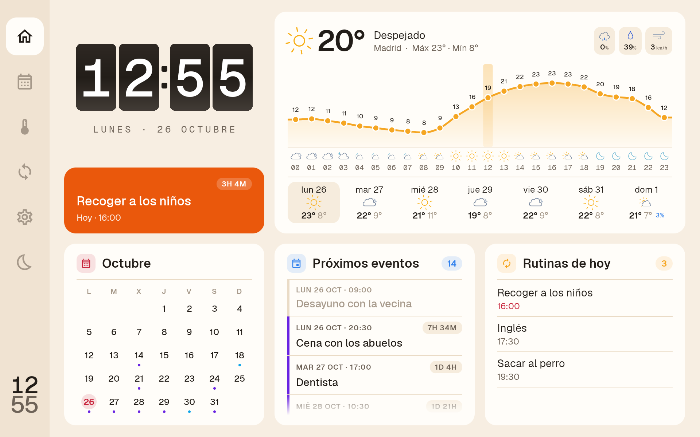
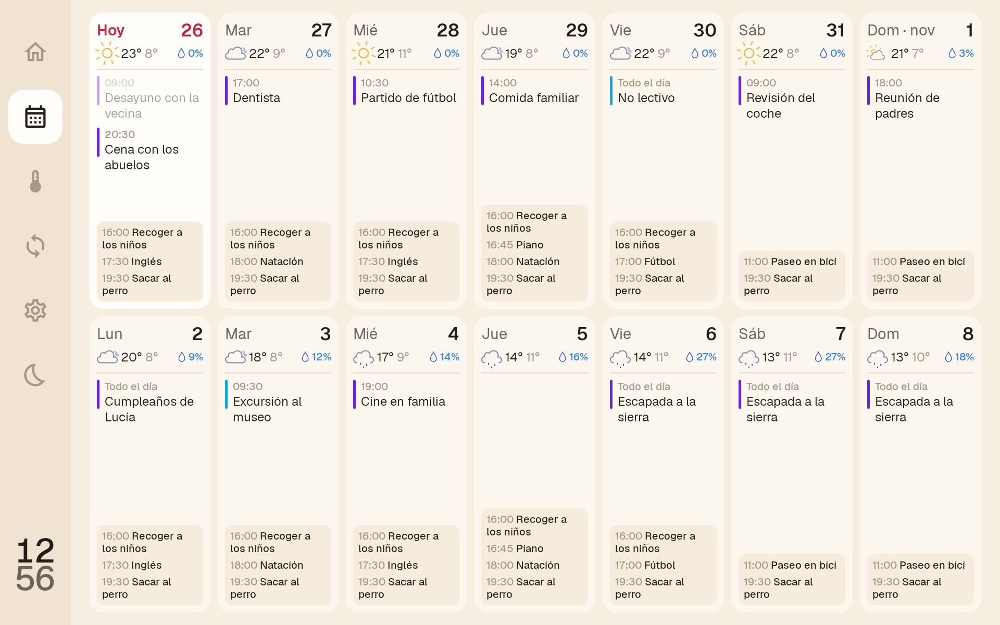
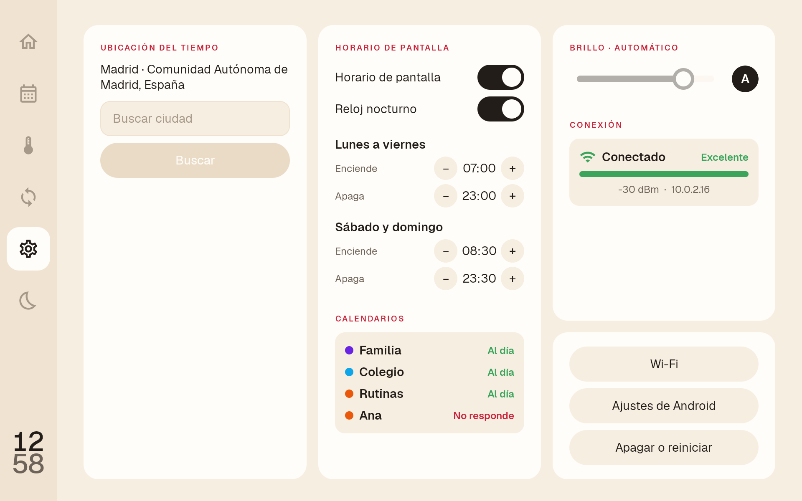
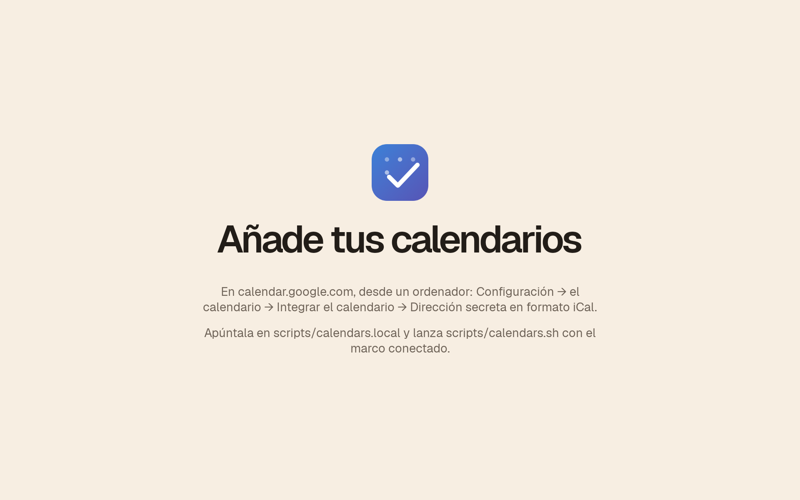

# Planify - Dashboard 🖼️

Un marco de fotos digital de unos 80 € convertido en la pantalla de la familia: hora, tiempo, eventos y rutinas de un vistazo, colgado en la pared, sin la app del fabricante y sin suscripciones.

**Este repositorio es, sobre todo, una guía para agentes** (Claude Code, Codex…) que quieran crear su propia versión: qué hay que hacer, en qué orden, con qué requisitos y qué se aprendió por el camino. Nosotros partimos de [wesbos/photo-frame-dashboard](https://github.com/wesbos/photo-frame-dashboard) de la misma forma.

Los datos salen de **Google Calendar**: el marco lee la «dirección secreta en formato iCal» de uno o varios calendarios, así que se siguen creando y editando como siempre, desde el móvil (iPhone o Android) o desde la web, y no hace falta servidor propio, ni cuenta de Google en el marco, ni nada que caduque. El tiempo viene de [Open-Meteo](https://open-meteo.com/), sin clave.

El proyecto nació conectado a [Planify-APP](https://github.com/eusonlito/Planify-APP) y [Planify-Backend](https://github.com/eusonlito/Planify-Backend) (app solo para Android); esa versión sigue en el historial de git, antes del commit «Calendarios de Google (iCal) en lugar de Planify».

**Pero puedes crear tu propia versión de todo sin problema:** usar otra fuente de datos (CalDAV, Home Assistant, un JSON propio…), otro diseño, otras pantallas u otro marco. La [fase 3](#fase-3-decide-de-dónde-salen-los-datos) explica qué hay que cambiar.

<p align="center">
  
</p>

---

## Índice

1. [Capturas](#capturas)
2. [Para agentes: empieza aquí](#para-agentes-empieza-aquí)
3. [El hardware](#el-hardware)
4. [Requisitos](#requisitos)
5. [Las fases, paso a paso](#las-fases-paso-a-paso)
6. [Qué hace la app](#qué-hace-la-app)
7. [Lo que aprendimos (léelo antes de improvisar)](#lo-que-aprendimos)
8. [Adaptarlo a otro marco](#adaptarlo-a-otro-marco)
9. [Estructura, licencias y créditos](#estructura)

---

## Capturas

Todas las secciones de la app, en el emulador con las medidas del marco (1920×1200) y los calendarios de demostración (`scripts/demo.sh`).

### Hoy
La pantalla principal: reloj de paletas, el siguiente evento o rutina con cuenta atrás (si es de hoy o de mañana), el tiempo (ahora, el día de hoy de 00 a 23 h con la hora actual marcada y los próximos días; deslizando sobre la curva se cambia de día), el calendario del mes, los próximos eventos (los 40 siguientes) y las rutinas de hoy. Los eventos de todo el día dicen «Todo el día» y no tienen cuenta atrás. Al tocar un día del calendario, la lista pasa a ser la de ese día. Las listas de eventos y rutinas se abren con un solo elemento pasado a la vista, el último, y vuelven a esa posición tras un minuto sin tocar la pantalla.



### Calendario
Dos filas, la semana actual y la siguiente, de lunes a domingo, deslizando en vertical de semana en semana. Cada día, en su tarjeta: el día y el número (hoy, en rojo), el tiempo en una línea, los eventos (los de varios días, en cada uno de ellos) y abajo, en una caja, las rutinas. Los días pasados, atenuados.



### Tiempo
Dos páginas que se deslizan. La primera: el día de hoy por horas, de 00 a 23 con la hora actual marcada, y 7 días. La segunda: la semana siguiente en gráfica (máximas, mínimas, lluvia y viento). Tocar cualquier día abre sus 24 horas con su propia cabecera, y deslizar sobre la gráfica pasa de un día a otro. La lluvia se dibuja por cantidad: el alto de la barra son los mm de esa hora, y la opacidad del relleno, la probabilidad (maciza al 100 %, vacía al 0 %).

<p align="center">
  
  
</p>
<p align="center">
  
</p>

### Ajustes
Ubicación del tiempo (búsqueda en Open-Meteo), horario de pantalla (entre semana y fin de semana, con el interruptor «Reloj nocturno»: si se desactiva, fuera de horario la pantalla se apaga del todo), **Calendarios** (cada uno con su color y si está al día o no responde, por ejemplo porque se ha restablecido su dirección en Google), brillo (un deslizador, con el porcentaje en el título, y «A» para el automático del sistema), Conexión (estado del Wi-Fi) y, en su propia caja, Wi-Fi, Ajustes de Android y apagar o reiniciar.



### Reloj nocturno
Fuera de horario, o al pulsar la luna de la barra lateral, la pantalla no se apaga: queda la hora en grande, la fecha y el tiempo de ahora, en negrita y en blanco sobre negro (también el icono, que en color apenas se veía), con la retroiluminación al mínimo (1 de 255). Tocarlo enseña el dashboard; fuera de horario, durante 5 minutos.


### Sin calendarios
Explica dónde sacar la dirección secreta y cómo pasarla al marco (`scripts/calendars.sh`): las URLs son demasiado largas para teclearlas en él. Sin Internet, en su lugar aparece "Esperando conexión a Internet…" con un botón a los ajustes de Wi-Fi.



---

## Para agentes: empieza aquí

Lo más probable es que estés ayudando a alguien con un marco conectado por USB a su ordenador. Lee esta sección entera, después el [hardware](#el-hardware) y, antes de cada fase, su apartado. No ejecutes nada de una fase si las comprobaciones de identidad no coinciden.

### Reglas

1. **Lee primero, escribe después.** Leer del marco está bien. Cualquier escritura (instalar, `settings put`, `/system`, particiones, flashear) necesita el permiso explícito del dueño **para esa acción concreta**; un permiso anterior no vale para la siguiente.
2. **Nada se escribe sin una copia verificada** de la eMMC ([fase 2](#fase-2-copia-de-seguridad-de-la-emmc)): tamaño exacto y SHA-256 de cada pieza comparado con el dispositivo.
3. **Para en la primera diferencia** de modelo, hash, tamaño o desplazamiento. Avisa al dueño en vez de buscar un rodeo.
4. **Un cambio cada vez**, con la forma de deshacerlo anotada antes de hacerlo.
5. **Los volcados son privados.** Contienen contraseñas Wi-Fi, tokens, números de serie y MACs. Van a `backups/` (en `.gitignore`) y nunca a un commit. Si publicas cambios, quita serie, MAC, IPs, SSID y dominios propios.
6. **No cierres la puerta por la que entraste.** Antes de quitar una vía de acceso (la app del fabricante, ADB por Wi-Fi, el cortafuegos), comprueba en el propio marco que tienes otra. Por USB, ADB funciona siempre en este modelo.
7. **Mide en el aparato.** El emulador no reproduce el calor, la memoria, el táctil ni la suspensión de esta placa (ver [lo que aprendimos](#lo-que-aprendimos)).
8. **Escribe notas mientras trabajas.** La ficha del marco ([docs/FRAME.md](docs/FRAME.md)) separa lo observado de lo supuesto; haz lo mismo con tu unidad.

### Documentación de este repositorio

| Documento | Para qué |
|---|---|
| [docs/FRAME.md](docs/FRAME.md) | Ficha completa del XORO CPF 10PF: identidad, particiones, software de fábrica, riesgos, TLS y escalera de recuperación |
| [docs/SETUP.md](docs/SETUP.md) | Qué hace `scripts/install.sh` paso a paso, primer uso, ADB por Wi-Fi, horario, arranque personalizado y cómo deshacerlo todo |
| [docs/ARCHITECTURE.md](docs/ARCHITECTURE.md) | Cómo está hecha la app: pantallas, capa de datos, estructura, emulador y tests |
| [docs/ANDROID.md](docs/ANDROID.md) | Hasta qué Android se podría actualizar el marco y por qué no compensa |
| [docs/inventory/](docs/inventory/) | Volcados del marco de fábrica (`getprop`, paquetes, particiones, sistema) para comparar con tu unidad |

---

## El hardware

**[XORO CPF 10PF](https://www.amazon.es/dp/B0G2MJBR3M)**, marco digital de 10,1" (unos 80 € en Amazon España). Lo importa MAS Elektronik AG y trae la app Uhale.

| | |
|---|---|
| **SoC** | Allwinner **A133** (`ro.hardware` = `sun50iw10p1`) |
| **CPU** | 4× ARM Cortex-A53, hasta 1,5 GHz |
| **GPU** | PowerVR GE8300 |
| **RAM** | **1 GB** (unos 435 MB libres en reposo), con zram |
| **Almacenamiento** | eMMC de 32 GB (26 GB para `/data`) y ranura microSD |
| **Pantalla** | IPS de 10,1", **1920×1200** (16:10). El panel es vertical (1200×1920) y Android lo gira. El anuncio dice 1920×1080, pero no es así. Densidad 320 dpi, 60 Hz |
| **Táctil** | Capacitivo `gslX680` (I²C) |
| **Wi-Fi** | Realtek RTL8189FS: **solo 2,4 GHz y sin WPA3** |
| **Sensores** | Solo acelerómetro. Sin sensor de luz ni de presencia |
| **Puertos** | USB-C (datos: ADB/MTP), USB-A (host), microSD, entrada DC, botón de encendido, reset (agujero) y volumen |
| **Alimentación** | Adaptador DC, **sin batería** |
| **Montaje** | VESA 75×75, gancho de pared y marco de madera desmontable |
| **Android** | **10** (API 29), parche de seguridad de enero de 2021, kernel 4.9 arm64 con **espacio de usuario de 32 bits** |
| **Build** | **`eng`**: ADB por USB **como root** de fábrica, SELinux permisivo, dm-verity desactivado |
| **Reloj (RTC)** | No conserva la hora sin red: arranca en la fecha de fábrica hasta que llega NTP |

**Por qué este marco:** el build `eng` da root por ADB desde el primer minuto, así que no hace falta ningún exploit ni desbloquear nada, y todo el proceso es reversible. El panel de 1920×1200 y los 4 núcleos dan para una app nativa fluida.

**Comprobaciones de identidad** (solo lectura; si algo no coincide, para):

```sh
adb devices -l                                  # USB 1f3a:1001, "CPF10PF"
adb shell getprop ro.hardware                   # sun50iw10p1
adb shell getprop ro.build.fingerprint          # Allwinner/uhale/uhale:10/QP1A.191105.004/eng.…:eng/test-keys
adb shell getprop ro.build.type                 # eng
adb shell id                                    # uid=0(root)
adb shell wm size                               # Physical size: 1920x1200
adb shell cat /sys/block/mmcblk0/size           # 61071360 (eMMC de 32 GB)
```

La ficha completa, con todas las particiones y el software de fábrica, está en [docs/FRAME.md](docs/FRAME.md).

---

## Requisitos

**En el ordenador** (probado en Linux):

| Herramienta | Para qué |
|---|---|
| `adb` (Android platform-tools) | Todo |
| JDK 17 o superior y el SDK de Android (compileSdk 37) | Compilar la app (`android/gradlew`) |
| `sha256sum`, `gzip` | Copia de seguridad |
| `mtools`, `dosfstools` (`fsck.vfat`) | Logo del bootloader (`scripts/boot/install.sh`) |
| Chrome/Chromium, ImageMagick, `zip` | Solo si regeneras el logo o la animación (`scripts/boot/make.sh`) |
| Python 3 y `npm` | Solo si regeneras los iconos del tiempo (`scripts/meteocons.py`) |

**Además:**
- Un cable **USB-C de datos** (no solo carga).
- Una red Wi-Fi de **2,4 GHz con WPA2** (el chip no soporta WPA3 ni 5 GHz). Mejor una red de invitados.
- Si usas esta app tal cual: uno o varios calendarios de Google con su «dirección secreta en formato iCal». Las cuentas de Google Workspace (trabajo, colegio) pueden tenerla desactivada por el administrador; las de Gmail, no.

---

## Las fases, paso a paso

`scripts/install.sh` hace las fases 2, 4, 5, 6, 7 y 8 de una vez (y, si existe `scripts/calendars.local`, pasa los calendarios de la fase 9) y es idempotente (repetirlo actualiza la app y vuelve a aplicar la configuración). Aun así, entiende cada fase antes de lanzarlo: el detalle de cada paso está en [docs/SETUP.md](docs/SETUP.md).

### Fase 1: identifica el marco

- **Objetivo:** confirmar que es exactamente este hardware y software.
- **Cómo:** las [comprobaciones de identidad](#el-hardware), y compara `getprop` y la lista de paquetes con [docs/inventory/](docs/inventory/).
- **Si no coincide:** no sigas con estos scripts. Ve a [Adaptarlo a otro marco](#adaptarlo-a-otro-marco).

### Fase 2: copia de seguridad de la eMMC

- **Objetivo:** poder volver al estado de fábrica pase lo que pase.
- **Cómo:** `scripts/frame/backup.sh` (lo llama `install.sh`). Copia todo lo anterior a `/data` (GPT, boot0/U-Boot, todas las particiones, unos 3 GiB), las particiones de hardware `boot0`/`boot1` y la GPT de respaldo, y compara el SHA-256 de cada pieza con el dispositivo. Lo guarda en `backups/<serie>/`.
- **Verificación:** `sha256sum -c SHA256SUMS` en esa carpeta. Guarda además una copia fuera del repositorio.
- **Deshacer:** no aplica; es la red de seguridad del resto.

### Fase 3: decide de dónde salen los datos

La app de este repositorio (`android/`) es un dashboard nativo en Kotlin y Jetpack Compose, de solo lectura, que lee calendarios iCal y Open-Meteo. Tienes tres caminos:

1. **Usarla con Google Calendar** (lo previsto): en [calendar.google.com](https://calendar.google.com), desde un ordenador, cada calendario tiene en *Configuración → el calendario → Integrar el calendario* su **dirección secreta en formato iCal**. Se pueden poner varios (el común de la familia, los de cada persona…): cada uno con su nombre y color, y si un evento está en dos, sale una vez. Ojo: la dirección enseña todo el calendario, también los eventos privados, y quien la tenga lo ve; si se filtra, «Restablecer» la cambia.
2. **Usarla con otra fuente iCal:** cualquier URL que sirva un `.ics` vale igual (iCloud con un calendario público, Nextcloud, Outlook…). Lo único propio de Google es dónde se saca la dirección.
3. **Otra fuente de datos o tu propia app:** la capa de datos está en `data/` (`ical/IcsParser.kt` y `repository/EventsRepository.kt`); las pantallas solo ven `Content(events, sessions)`. Si haces otra app, respeta lo que pide el marco ([lo que aprendimos](#lo-que-aprendimos)): minSdk 29, sin librerías nativas (32 bits), diseño en los píxeles nativos y cuidado con las animaciones continuas y la memoria. Si es una web, wesbos usa una WebView en modo quiosco; aquí se descartó por memoria y calor.

Las **rutinas** (lo que se repite cada semana: recoger a los niños, extraescolares…) salen de los calendarios marcados como `rutinas`: lo más cómodo es un calendario aparte en Google, con eventos que se repiten. Las **tareas** de Planify no tienen equivalente en iCal y no se muestran.

### Fase 4: configura y compila

```sh
cp scripts/config.example scripts/config.local
#   ADB_FROM=<ip-de-tu-pc>                     única IP que podrá usar ADB por Wi-Fi (vacía: solo USB)
#   FRAME_TIMEZONE=Europe/Madrid               opcional (por defecto, la de tu PC)
#   FRAME_NTP=pool.ntp.org                     opcional
```

`config.local` está en `.gitignore`. La compilación no necesita ninguna URL: los calendarios se pasan a la app ya instalada (fase 9). Hace falta JDK 17 (`JAVA_HOME`): con versiones mucho más nuevas Gradle puede no arrancar.

Antes de tocar el marco, se puede probar en un emulador con sus medidas (API 29, 1920×1200, 320 dpi, 1 GB) y los calendarios de demostración: ver [docs/ARCHITECTURE.md](docs/ARCHITECTURE.md#desarrollo). El emulador pide unos 2 GB de RAM y, con Gradle abierto a la vez, puede dejar sin memoria un PC de 16 GB.

### Fase 5: instala y convierte el marco en quiosco

```sh
scripts/install.sh --build        # la primera vez, por USB
```

- **Device Owner:** `dpm set-device-owner`. Android solo lo permite **sin cuentas** en el dispositivo; el script lo comprueba. Desde ahí la app se fija en lock task (sin botones de inicio ni recientes), quita el bloqueo y la barra de estado, y se registra como launcher.
- **Apps de fábrica:** desactiva Uhale (`com.zeasn.frame`, con [problemas de seguridad conocidos](https://go.quokka.io/hubfs/App-Intel/Technical_Uhale-Digital-Picture-Frame-Security-Assessment.pdf)) y las herramientas de Allwinner con `pm disable-user`, que es reversible. La app de pruebas de fábrica `com.example` se desinstala para el usuario 0 porque es *persistent* y arrancaría igualmente.
- **Ajustes del sistema:** NTP y zona horaria, sin sonidos ni animaciones, Bluetooth y localización apagados, sin pantalla de bloqueo.
- **Permisos de la app:** `SYSTEM_ALERT_WINDOW` para el botón flotante de volver al dashboard desde Ajustes de Android, y un servicio de accesibilidad para abrir el menú de apagar/reiniciar.
- **Deshacer:** [docs/SETUP.md, Mantenimiento y vuelta atrás](docs/SETUP.md#mantenimiento-y-vuelta-atrás).

### Fase 6: aísla el marco

- **Objetivo:** que solo el dashboard salga a Internet.
- **Cómo:** `install.sh` copia `scripts/frame/planify-frame.sh` y su `.rc` a `/system` (necesita `adb remount`). En cada arranque montan un **cortafuegos por UID**: el UID del dashboard sale a Internet y el resto del sistema solo a la red local, DNS y NTP. No admite conexiones entrantes salvo ADB desde `ADB_FROM`. Además, `su` pasa a `root:shell 4750`: ADB sigue siendo root, pero las apps ya no.
- **Verificación:** `adb shell iptables -S FRAME_OUT` y `adb shell iptables -S FRAME_IN`.

### Fase 7: actualizaciones por Wi-Fi

- **Cómo:** con `ADB_FROM` configurado, `install.sh` activa `persist.adb.tcp.port=5555`. El cortafuegos solo deja entrar al 5555 desde esa IP, y `adbd` sigue pidiendo la clave autorizada.
- **Uso:**
  ```sh
  adb connect <ip-del-marco>:5555
  ANDROID_SERIAL=<ip-del-marco>:5555 scripts/install.sh --build --no-backup
  ```
- **Importante:** reserva en el router una IP para tu PC y otra para el marco, y configura la red del marco con «Usar MAC del dispositivo» (Android 10 usa una MAC aleatoria por red).

### Fase 8: arranque y energía

- **Arranque personalizado** (`scripts/boot/install.sh`): sustituye el logo del bootloader y la animación de arranque por los de Planify. La partición FAT del bootloader **declara 128 MB pero mide 32 MB**, y justo detrás va `env`, así que nunca se monta en el marco: se edita una copia en el PC, se comprueba que ningún clúster cae fuera y se escribe verificando el hash. `--restore` vuelve a los de fábrica.
- **Horario de pantalla:** fuera de horario, por defecto, la pantalla se queda con un **reloj nocturno** (hora, fecha y tiempo sobre negro, con la retroiluminación al mínimo); tocarlo enseña el dashboard 5 minutos. Si se desactiva en Ajustes, la pantalla se apaga de verdad con `lockNow()` y se enciende con una alarma exacta; el táctil no la despierta (el botón de encendido sí) y, encendida fuera de horario, se vuelve a apagar a los 5 minutos.
- **Sin suspensión del kernel:** el script de arranque deja un wakelock del kernel (`/sys/power/wake_lock`), porque en esta placa la suspensión está rota (ver [lo que aprendimos](#lo-que-aprendimos)).

### Fase 9: primer uso

1. **Wi-Fi:** en el dashboard, Ajustes (la rueda) → Wi-Fi; o "Ir a Ajustes" en la pantalla de espera, si aún no hay calendarios. Elige «Usar MAC del dispositivo» en las opciones avanzadas de la red, para poder reservarle la IP en el router. Si el router está en modo mixto WPA2/WPA3, añade la red a mano como WPA/WPA2-Personal ([docs/SETUP.md, Primer uso](docs/SETUP.md#primer-uso)).
2. **Calendarios:** en el PC, `cp scripts/calendars.example scripts/calendars.local` (está en `.gitignore`), una línea por calendario (`nombre | #color | dirección secreta | rutinas`) y `scripts/calendars.sh` con el marco conectado. Los escribe en la app por ADB y la reinicia; para cambiarlos, se edita el fichero y se repite. Nunca subas ese fichero ni pegues las direcciones en ningún sitio.
3. **Ajustes del dashboard:** ubicación del tiempo, horario de pantalla y brillo. En Ajustes → Calendarios, cada uno debe decir «Al día».

### Fase 10: verificación final

- [ ] Reinicia el marco: arranca en el logo propio y después en el dashboard, en horizontal, sin barra de estado ni bloqueo.
- [ ] `iptables -S FRAME_OUT` rechaza la salida de otros UIDs, y ADB por Wi-Fi solo funciona desde tu IP.
- [ ] Sin red, el dashboard sigue mostrando los últimos datos y dice "Sin conexión".
- [ ] El horario apaga y enciende la pantalla, y tras una noche el táctil responde.
- [ ] Tras una hora: `dumpsys meminfo com.lito.planify.dashboard` (unos 175 MB) y la temperatura (`/sys/class/thermal/thermal_zone*/temp`, unos 60 °C).

---

## Qué hace la app

Barra lateral con Hoy, Calendario, Tiempo, sincronizar, Ajustes y apagar pantalla. Tras 2 minutos sin tocar, vuelve a Hoy.

| Pantalla | Contenido |
|---|---|
| **Hoy** | Reloj de paletas (split-flap), el siguiente evento o rutina con cuenta atrás (si es de hoy o de mañana), el tiempo (ahora, el día de hoy de 00 a 23 h con la hora actual marcada y los próximos días, que se deslizan), calendario del mes, próximos eventos y rutinas de hoy |
| **Calendario** | Dos semanas en dos filas, deslizando en vertical: el tiempo de cada día, los eventos y una caja con las rutinas |
| **Tiempo** | Hoy de 00 a 23 h y 7 días; la semana siguiente en gráfica; tocar un día abre sus 24 horas con su cabecera |
| **Reloj nocturno** | Fuera de horario, o al pulsar la luna: hora, fecha y tiempo sobre negro con el brillo al mínimo; tocarlo enseña el dashboard |
| **Ajustes** | Ubicación del tiempo (Open-Meteo), horario de pantalla (con reloj nocturno o apagado), estado de cada calendario, brillo (deslizador o automático), Conexión (estado del Wi-Fi) y los botones de Wi-Fi, Ajustes de Android y apagar o reiniciar |

Por dentro (detalle en [docs/ARCHITECTURE.md](docs/ARCHITECTURE.md)):
- **Píxeles nativos:** la app fija `Density(1f)`, así que todo se diseña en los 1920×1200 píxeles del panel (1 dp = 1 px), sin tocar la densidad del sistema.
- **Calendarios iCal:** cada uno se descarga entero cada 5 minutos y se expanden sus repeticiones (con [biweekly](https://github.com/mangstadt/biweekly)) de 12 meses atrás a 12 meses adelante. Antes se descartan los eventos sueltos fuera de ese rango, porque el fichero trae años de historial y el marco tiene 1 GB.
- **Sin red, todo como la última vez:** cada dato se guarda en disco con escritura atómica y se pinta desde ahí (*stale-if-error*); si un calendario falla, los demás siguen. Calendarios cada 5 minutos, tiempo cada 30.
- **Hora fiable:** como el RTC no guarda la hora, nada anterior a la compilación de la app se toma por bueno ("Sincronizando hora…"), y sin hora válida no se apaga la pantalla ni se pide nada.
- **Iconos del tiempo animados** ([Meteocons](https://github.com/basmilius/meteocons)), pre-renderizados una vez a su tamaño para no calentar el marco.
- **Máximas y mínimas** calculadas a partir de las horas, para que coincidan siempre con la gráfica.

---

## Lo que aprendimos

Cosas de este marco que no se ven en el emulador y que costaron tiempo. Tenlas en cuenta en cualquier versión:

- **Suspensión del kernel rota.** Con la pantalla apagada y sin USB, Android intenta suspender: falla por el acelerómetro (`mir3da`), el táctil se queda muerto hasta recargar su módulo (`rmmod`/`insmod gslX680new.ko`) y el servicio de suspensión aborta, así que Android se reinicia al despertar. Por USB nunca se ve, porque el USB mantiene el sistema despierto. Solución: un wakelock del kernel permanente.
- **Wi-Fi sin WPA3 ni 5 GHz.** Con routers en modo mixto, Android guarda la red como WPA3 y el driver la rechaza. Además, el driver no le pasa la señal a Android (RSSI -127) y, con la localización apagada, Android oculta el nombre de la red: los dos se leen de `/proc/net/rtl8189fs/wlan0/`.
- **El RTC no guarda la hora.** Arranca en la fecha de fábrica hasta que llega NTP. Cualquier horario o fecha que se calcule antes sale mal.
- **1 GB de RAM y calor.** Dibujar animaciones Lottie en cada fotograma llevó el marco a 1–2 núcleos y 72 °C. Pre-renderizando los fotogramas, se queda en un 25–37 % de un núcleo y unos 60 °C. Nada de vídeo ni animaciones continuas innecesarias.
- **Escalas de animación a 0.** El script las pone a 0 para que Android no anime nada, y Compose las respeta: las animaciones que sí quieras tienen que forzar su propia escala.
- **Sin barra de navegación.** Al abrir Ajustes de Android dentro del quiosco no hay forma de volver: la app pone un botón flotante de inicio y vuelve sola tras un minuto sin tocar.
- **Apagar el marco.** Ni siendo Device Owner se puede apagar Android desde una app; un servicio de accesibilidad sí puede abrir el menú nativo de apagar/reiniciar. Mantener el botón de encendido unos 10 s corta la corriente de golpe.
- **El táctil no despierta la pantalla apagada**; el botón de encendido sí.
- **La partición FAT del bootloader miente sobre su tamaño.** Montarla y escribir en el marco puede pisar `env` o `boot`.
- **El anuncio miente sobre la resolución** (dice 1920×1080 y es 1920×1200).

---

## Adaptarlo a otro marco

Muchos marcos parecidos usan el mismo SoC A133 o placas Rockchip, pero cambian el build (muchos son `user`, sin root), las particiones, el táctil y el Wi-Fi.

**Específico de este marco (revísalo siempre):**
- La comprobación de `ro.hardware` en `scripts/install.sh` (no la quites: cámbiala por la de tu marco).
- `scripts/frame/backup.sh`: la partición de datos es `mmcblk0p17` y hay `boot0`/`boot1`.
- `scripts/boot/`: el logo es un BMP de 1200×1920 en vertical dentro de una FAT con el tamaño mal declarado.
- La lista de paquetes de fábrica que se desactivan (Uhale, Allwinner, `com.example`).
- El wakelock contra la suspensión, y los nombres del driver de Wi-Fi y del módulo del táctil.
- Las medidas de la app: está diseñada en píxeles nativos para 1920×1200.

**Genérico (sirve casi igual en cualquier Android 10 con root por ADB):** el quiosco con Device Owner, el cortafuegos por UID, ADB por Wi-Fi desde una sola IP, el horario de pantalla y la capa de datos con caché.

**Sin root por ADB:** el camino es otro (fastboot, FEL, parchear `boot`…). Empieza por [wesbos/photo-frame-dashboard](https://github.com/wesbos/photo-frame-dashboard), que documenta varios modelos y sus rutas. Si tu marco es un A133 como el LOOFII C-3, su [guía del A133](https://github.com/wesbos/photo-frame-dashboard/blob/main/docs/allwinner-a133-loofii-c3.md) es la más cercana a esta.

---

## Estructura

```
android/              app Android (Kotlin, Jetpack Compose, minSdk 29)
scripts/install.sh    fases 2 y 4 a 8; se configura con scripts/config.local (config.example)
scripts/calendars.sh  calendarios de la app, desde scripts/calendars.local (calendars.example)
scripts/demo.sh       emulador con calendarios de demostración (scripts/demo/calendars.py)
scripts/frame/        backup.sh (eMMC), planify-frame.sh y .rc (cortafuegos y wakelock al arrancar)
scripts/boot/         logo del bootloader y animación de arranque (boot.html → make.sh → install.sh)
scripts/meteocons.py  iconos del tiempo para la app
docs/                 FRAME, SETUP, ARCHITECTURE, ANDROID, inventory/ e images/
```

## Licencias

- Código: [MIT](LICENSE).
- Fuentes [Geist y Geist Mono](https://vercel.com/font): SIL Open Font License ([licenses/Geist-OFL.txt](licenses/Geist-OFL.txt)).
- Iconos del tiempo [Meteocons](https://github.com/basmilius/meteocons) de Bas Milius: MIT ([third_party/meteocons/LICENSE](third_party/meteocons/LICENSE)).

## Créditos

- [wesbos/photo-frame-dashboard](https://github.com/wesbos/photo-frame-dashboard): la idea, el método y la documentación del A133 (LOOFII C-3) en la que se basan la copia de seguridad, la recuperación y el cortafuegos.
- [Open-Meteo](https://open-meteo.com/): la previsión del tiempo, libre y sin clave.
